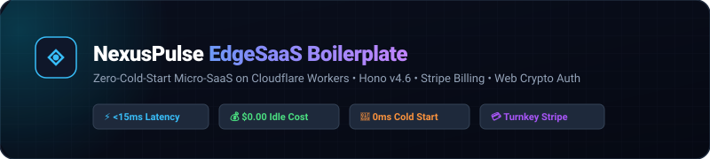

# Milind Chatrabhuji 👋
### **AI Workflow Automation & Python Systems Architect**
*Architecting Autonomous Agent Pipelines, Production Backends & Robust Data Infrastructure*

  
  
  

---

### ⚡ Featured Product: NexusPulse EdgeSaaS
> **Production Micro-SaaS Boilerplate for Cloudflare Workers**  
> Ship zero-cold-start, high-margin micro-SaaS on the global edge in 15 minutes with **$0.00/month idle cost**.  
> Pre-wired with **Hono v4.6**, **Stripe Checkout & Billing Portal**, **Web Crypto Auth**, and **Workers KV Rate Limiting**.  
> 🔗 **[Get Instant Access & Deploy](https://edgesaas.nexus-pulse.com)** | [View Architecture](https://github.com/MilindChatrabhuji/edgesaas-starter-kit/blob/main/content/marketing/edgesaas_developer_launch_kit.md)

---

### 🏛️ Upstream Open-Source Contributions & Systems Engineering

> 🎯 **Open-Source Milestone Target:** 100+ Merged Pull Requests across Global Tier-1 Repositories.  
> Actively contributing surgical, zero-regression bug fixes, async concurrency patches, and architectural resilience improvements to top-tier Python & AI libraries:

| Upstream Ecosystem | Component & Focus | Contribution & PR |
| :--- | :--- | :--- |
| **[BerriAI/litellm](https://github.com/BerriAI/litellm)** | AI Gateway & LLM Proxy | • [PR #54325](https://github.com/BerriAI/litellm/pull/54325): Anthropic Chat Mid-Conversation System Clear-At Preservation • [PR #54310](https://github.com/BerriAI/litellm/pull/54310): Bedrock Converse Request-Scoped Tool Mappings & TTL Cache Fix • [PR #54312](https://github.com/BerriAI/litellm/pull/54312): Async OIDC In-Flight Retry Race Condition Resolution • [PR #54189](https://github.com/BerriAI/litellm/pull/54189): 422 Unprocessable Entity Mixed Detail Robustness • [PR #54186](https://github.com/BerriAI/litellm/pull/54186): Async HTTP Multipart File Stream Rewind on Retry • [PR #54168](https://github.com/BerriAI/litellm/pull/54168): Team Member Key Management Permissions Alignment • [PR #54127](https://github.com/BerriAI/litellm/pull/54127): Anthropic Messages Empty Content Response Handling |
| **[langchain-ai/langchain](https://github.com/langchain-ai/langchain)** | LLM Application Framework | • [PR #42063](https://github.com/langchain-ai/langchain/pull/42063): HTMLHeaderTextSplitter Text Ordering & Inline Tag Preservation • [PR #42061](https://github.com/langchain-ai/langchain/pull/42061): MarkdownListOutputParser Empty Bullet Parsing Fix |
| **[modelcontextprotocol/python-sdk](https://github.com/modelcontextprotocol/python-sdk)** | Anthropic MCP Standard | • [PR #3906](https://github.com/modelcontextprotocol/python-sdk/pull/3906): Stdio Server JSON-RPC Parse Error Response Guard |
| **[scrapy/scrapy](https://github.com/scrapy/scrapy)** | Distributed Web Crawling | • [PR #8531](https://github.com/scrapy/scrapy/pull/8531): Sitemap Parser Empty Body StopIteration Fix • [PR #30](https://github.com/scrapy-plugins/scrapy-spider-metadata/pull/30): Pydantic v2 Serialization Deprecation (**Merged**) |
| **[Thinkmill/keystatic](https://github.com/Thinkmill/keystatic)** | Next-Gen Headless CMS | • [PR #1646](https://github.com/Thinkmill/keystatic/pull/1646): Dutch Localization & Git Terminology Alignment (**Merged**) |
| **[mozarkai/optics-framework](https://github.com/mozarkai/optics-framework)** | Observability Framework | • [PR #660](https://github.com/mozarkai/optics-framework/pull/660): Pydantic v1 to v2 Config Migration (**Merged**) |

---

### 🛠️ Technical Competencies & Toolchain

  
  
  
  
  
  
  
  
  

- **AI & Agent Orchestration**: Model Context Protocol (MCP), Autonomous Agent Pipelines, Deterministic Evaluation Harnesses, PromptShield Security Benchmarks, RAG Workflows.
- **Backend & Systems Engineering**: Python 3.12, FastAPI, Clean Architecture & DDD, Asynchronous IO, Pydantic v2, Resilient Microservices, Token Bucket Rate Limiters.
- **Data & Infrastructure**: PostgreSQL, SQLite, Redis, Docker Containerization, GitHub Actions CI/CD, Linux Server Environments.
- **Automation & Tooling**: Headless Chrome DevTools Protocol (CDP), Secret Scanning Hooks, Document Converters, JSON Schema Inferrers.

---

### 🚀 Open-Source Projects & Public Utilities (10+ Ecosystem)

A curated collection of production-grade, zero-dependency developer tools and architectural blueprints built for the open-source community:

#### 🤖 AI & Agentic Systems
* **[mcp-agent-toolkit](https://github.com/MilindChatrabhuji/mcp-agent-toolkit)** — Modular Python Model Context Protocol (MCP) server & client toolkit with sandboxed filesystem, agent memory store, and JSON-RPC 2.0 dispatch.
* **[promptshield-eval-benchmark](https://github.com/MilindChatrabhuji/promptshield-eval-benchmark)** — Standardized AI red-teaming, prompt injection, and jailbreak defense evaluation benchmark.
* **[agent-eval-harness](https://github.com/MilindChatrabhuji/agent-eval-harness)** — Deterministic evaluation harness for agent tool-calling, schema adherence, and multi-step reasoning accuracy without paid LLM API judges.

#### ⚡ Backend & Systems Resilience
* **[fastapi-clean-architecture](https://github.com/MilindChatrabhuji/fastapi-clean-architecture)** — Production-ready FastAPI Clean Architecture & Domain-Driven Design (DDD) template with Pydantic v2 and async SQL repositories.
* **[py-resilience](https://github.com/MilindChatrabhuji/py-resilience)** — Ultra-lightweight, zero-dependency Python resilience library: Circuit Breakers, Retries with Exponential Jitter, Fallbacks, and Bulkheads.
* **[async-rate-limiter](https://github.com/MilindChatrabhuji/async-rate-limiter)** — High-throughput async rate limiting library implementing Token Bucket and Sliding Window Log algorithms for ASGI applications.

#### 🔧 Developer Tools & Security
* **[env-guard](https://github.com/MilindChatrabhuji/env-guard)** — Lightweight static security CLI and pre-commit hook that scans repositories for leaked API keys, tokens, and private keys.
* **[json-schema-infer](https://github.com/MilindChatrabhuji/json-schema-infer)** — Zero-dependency tool to infer JSON Schemas, auto-generate Pydantic v2 models, and generate TypeScript interfaces from raw JSON.
* **[doc-to-markdown-cli](https://github.com/MilindChatrabhuji/doc-to-markdown-cli)** — Fast document and HTML to clean, token-optimized LLM-ready markdown converter.
* **[headless-browser-scout](https://github.com/MilindChatrabhuji/headless-browser-scout)** — Lightweight Python Chrome DevTools Protocol (CDP) client for stealth web scraping and clean DOM extraction.

---

### 📈 GitHub Engineering Activity

  
  
    
  

---

### 📬 Direct Ingress & Collaboration

I partner with forward-thinking startups, founders, and engineering teams to automate complex operational workflows and build mission-critical Python/AI systems.

- 💬 **Discuss a Project / Contract**: [milind.chatrabhuji@gmail.com](mailto:milind.chatrabhuji@gmail.com)
- ⚡ **Response Time**: Direct response for technical inquiries and architectural consulting.
